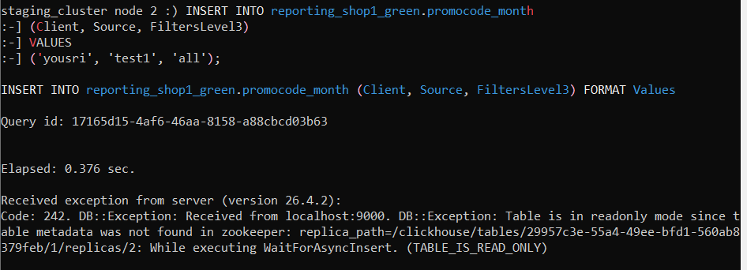
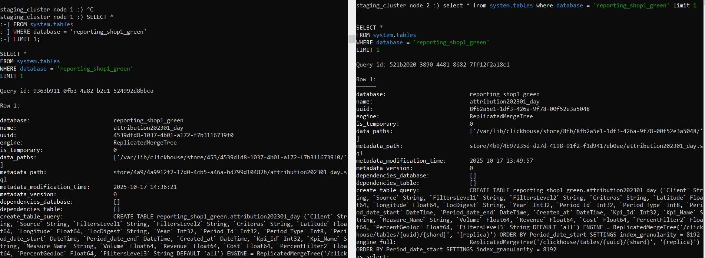
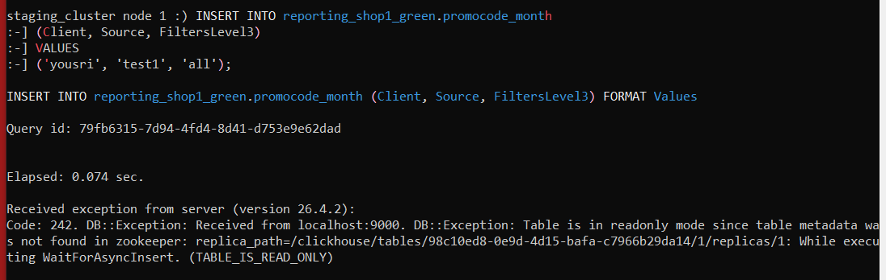
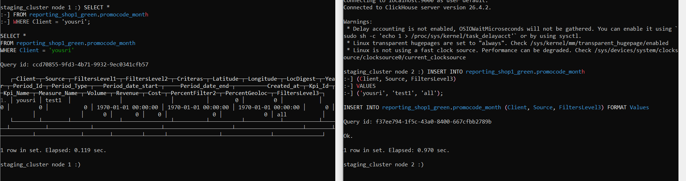

### First thing: reproduce the problem manually

Before reading any logs or config, I wanted to see the failure with my own eyes.  
I picked a table and tried a simple INSERT on `ch02`:

```sql
INSERT INTO reporting_shop1_green.promocode_month (Client, Source, FiltersLevel3)
VALUES ('yousri', 'test1', 'all');
```



```
Code: 242. DB::Exception: Table is in readonly mode since table metadata
was not found in zookeeper: replica_path=/clickhouse/tables/29957c3e-.../replicas/2
```

This was unexpected. The symptom described was "ch02 inserts fine but ch01 doesn't receive them."  
But here **ch02 itself is refusing writes**. The error message mentions `zookeeper` and `replica_path`   
I didn't know what those meant yet, so I stopped and went to read.

---

### Understanding the system and Documentation

At this point I had no mental model of how ClickHouse handles replication, so I used  the official documentation to understand the architecture before touching anything.

Key things I learned:

**ReplicatedMergeTree** is ClickHouse's replicated table engine.  
Every table using it is registered in a coordination service (Keeper / ZooKeeper) under a path that includes the table's UUID:
```
/clickhouse/tables/{uuid}/{shard}
```
> Reference: [ReplicatedMergeTree ClickHouse docs](https://clickhouse.com/docs/en/engines/table-engines/mergetree-family/replication)

I confirmed our tables were using this engine:

```sql
SELECT name, engine FROM system.tables
WHERE database = 'reporting_shop1_green' LIMIT 1;
```

Engine: `ReplicatedMergeTree`  confirmed. So every table needs to be registered in Keeper to accept writes. If the path doesn't exist in Keeper, the table locks itself into **readonly mode** as a safety measure.

That explained the error. `ch02`'s own replica path didn't exist in Keeper.

---

### Why is ch02 not registered in Keeper?

I queried the Keeper tree directly:

```sql
SELECT * FROM system.zookeeper
WHERE path = '/clickhouse/tables'
FORMAT Vertical;
```

> I learned about `system.zookeeper` from: [ClickHouse docs  system.zookeeper](https://clickhouse.com/docs/en/operations/system-tables/zookeeper)

Result: **empty**. The entire `/clickhouse/tables` tree had nothing in it.  
This meant the Keeper volumes were never restored when the cluster was recreated  the coordination state was wiped clean.

---

### Reading the full replica state

I now knew about `system.replicas`  the main diagnostic table for replication health.  
> Reference: [ClickHouse docs  system.replicas](https://clickhouse.com/docs/en/operations/system-tables/replicas)

```sql
SELECT database, table, is_readonly, total_replicas,
       active_replicas, absolute_delay, zookeeper_exception
FROM system.replicas
FORMAT Vertical;
```


What I found on both nodes:

| Signal | Value | What it means |
|---|---|---|
| `is_readonly` | `1` | table is locked, no writes accepted |
| `total_replicas` | `0` | node is not part of any replication group in Keeper |
| `absolute_delay` | ~1.78 billion sec | never synced since table creation |
| 

The `total_replicas = 0` was the key signal. I learned that:
- `total_replicas ≥ 1` + `is_readonly` = simple disconnect → fix with `SYSTEM RESTART REPLICA`
- `total_replicas = 0` = path doesn't exist at all → need `SYSTEM RESTORE REPLICA`

> Reference: [SYSTEM RESTORE REPLICA](https://clickhouse.com/docs/en/sql-reference/statements/system#restore-replica)

The 1.78 billion second delay also confirmed this was not a recent blip  the nodes had **never** been in sync.

---

### So why did the Keeper path never exist?  The UUID discovery

This is where I dug deeper. The Keeper path for a table is:
```
/clickhouse/tables/{uuid}/{shard}/replicas/{replica}
```

The `{uuid}` is the table's own UUID generated at creation time. I asked myself: what if `ch01` and `ch02` created their tables independently, each getting a different UUID? They would register under completely different Keeper paths  invisible to each other.

I compared UUIDs across both nodes:

```sql
-- run on ch01 then ch02, compare the uuid column
SELECT database, name, uuid FROM system.tables
WHERE database = 'reporting_shop1_green'
AND engine LIKE 'Replicated%';
```



```
ch01  attribution202301_day → uuid: 4539dfd8-1037-4b01-a172-f7b3116739f0
ch02  attribution202301_day → uuid: 8fb2a5e1-1df3-426a-9f78-00f52e3a5048
```

Not a single UUID matched across all 88 tables in all 4 databases.

The tables were created separately on each node. Each creation generated a fresh UUID.  
`ch01` was watching `/tables/4539dfd8.../1`  `ch02` was at `/tables/8fb2a5e1.../1`.  
Completely separate addresses. They never communicated.

---

### Also: ch01 readonly for a different path

```sql
-- on ch01
INSERT INTO reporting_shop1_green.promocode_month (Client, Source, FiltersLevel3)
VALUES ('yousri', 'test1', 'all');
```



Same readonly error but with ch01's own UUID in the path. Both nodes unregistered, both have different UUIDs  two compounding problems.

---

## Root Cause Summary

| Problem | Cause |
|---|---|
| Both nodes readonly | Keeper volumes wiped  no replica paths exist in Keeper |
| Replication never worked | Tables created independently → different UUIDs → separate Keeper namespaces |

---

## The Fix

### Why order matters

We must align UUIDs on `ch01` **before** restoring Keeper on `ch02`.  
If Keeper path exists first, `ch01`'s watcher thread fires mid-recreation and causes partial registration.

### Phase 2A  Align ch01 UUIDs to ch02

`ch02` is the source of truth  it has the actual data on disk.  
For all 88 tables: read ch02's UUID, DROP the orphaned table on ch01, recreate it with the correct UUID.

```bash
pip install requests
python3 match_UUID.py
```

Both nodes now address the same Keeper path. Keeper is still empty at this point.

### Phase 2B  Rebuild Keeper from ch02's disk

`SYSTEM RESTORE REPLICA` reads ch02's local data parts and writes the registration into Keeper from scratch. Once that path exists, **ch01's background watcher thread detects it automatically**, registers itself as replica 1, and starts fetching the missing parts  no manual intervention needed.

```bash
python3 restore.py
```

---

## Verification

```sql
SELECT database, table, is_readonly, active_replicas, total_replicas, absolute_delay
FROM system.replicas
ORDER BY database, table
FORMAT PrettyCompact;
-- expected: is_readonly=0, active_replicas=2 for every table
```



INSERT on `ch02` → row visible on `ch01` within seconds. ✓

---

## No Downtime

`ch02` was never taken offline  all live traffic stayed on it throughout.  
`ch01` was already readonly before we touched it, so the DROP+recreate window was not additional downtime.  
The historical sync (ch01 catching up on all parts) runs in the background while production continues.

